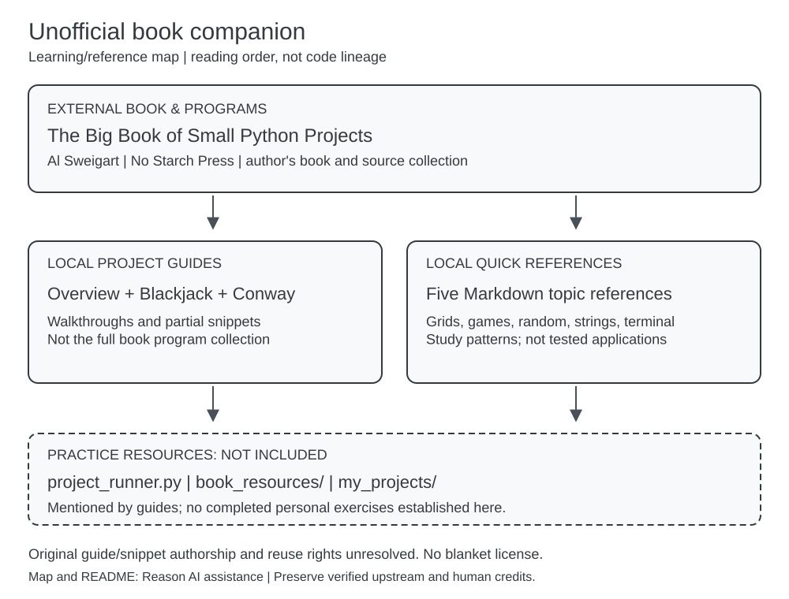

# Big Book Python Companion

An **unofficial learning/reference companion** to *The Big Book of Small Python Projects* by **Al Sweigart**, published by **No Starch Press**. This repository contains study guides and instructional Python snippets, not the book's full program collection or evidence of 81 completed personal exercises. It is not an official author/publisher project or an integrated application.

## Start reading

No installation, build, service, API, or Python runtime is needed to read these Markdown files. Open them on GitHub or in a Markdown-capable editor.

- [Project overview](project_guides/PROJECTS_OVERVIEW.md): a broad topic index; use the [author's book index](https://inventwithpython.com/bigbookpython/) as the authoritative chapter navigation. Some local project numbers/links are inconsistent (for example, Cho-Han is book project #10, not #17).
- [Blackjack guide](project_guides/blackjack_guide.md): card representation, hand values, and partial game-loop walkthroughs; book project #4.
- [Conway's Game of Life guide](project_guides/conways_game_of_life_guide.md): grids, cellular automata, and double buffering; book project #13.
- Quick references: [dictionary coordinates](quick_reference/dictionary_coordinates.md), [game patterns](quick_reference/game_development_patterns.md), [random generation](quick_reference/random_generation.md), [string manipulation](quick_reference/string_manipulation.md), and [terminal graphics](quick_reference/terminal_graphics.md).
- [Learning/reference map and editing instructions](docs/README.md), with an [editable Excalidraw source](docs/learning-map.excalidraw).



## What is actually here

The original source snapshot contains eight Markdown documents (three project guides/index files and five quick references) plus `.gitignore`. This documentation update adds this README and the diagram/documentation tooling; it does not add exercise implementations. There are no tracked `.py` exercise files, package/dependency manifests, application entry points, tests, or CI workflows in that original snapshot.

The guides contain meaningful example code, but code fences are not a validated runnable package. Some need omitted helpers or implementation work: Blackjack's main-loop excerpt leaves winner determination as a comment, and the game template includes placeholder validation and game logic. Treat snippets as study material requiring review, not production-ready or tested implementations. Original guide text and snippets are preserved; this cleanup does not correct their algorithms or chapter mappings.

### Setup and command status

The existing guides refer to `project_runner.py`, `book_resources/`, and `my_projects/`. **None is included in the tracked source snapshot.** Their launch commands below are historical documentation, **NOT RUN**, and cannot work against this checkout as written:

```bash
python project_runner.py --run blackjack
python book_resources/blackjack.py
python project_runner.py --run conwaysgameoflife
python book_resources/conwaysgameoflife.py
```

For a complete program, consult the relevant book chapter or [author's source collection](https://github.com/asweigart/the-big-book-of-small-python-projects), separately from this repository. Follow that resource's own requirements and notices; do not assume filenames or a runner from these guides exists upstream.

**Inferred native environment, not verified:** extracted examples target Python 3 (some syntax implies Python 3.6+; this is not a tested support policy), and terminal examples may need an interactive Unicode/ANSI-capable terminal. The terminal guide mentions optional Bext and `pip install Bext`; that command was **NOT RUN**, no dependency version is pinned here, and no installation is required for reading. Windows `cls` and Unix-like `clear` examples describe platform-specific terminal behavior, not verified cross-platform support. There is no application build/test command to standardize in this documentation-only collection.

## Sources, credits, and reuse

- **Book and original book programs:** Al Sweigart, *The Big Book of Small Python Projects*, No Starch Press. [Author-hosted book](https://inventwithpython.com/bigbookpython/), [publisher](https://nostarch.com/big-book-small-python-projects), and [author's source repository](https://github.com/asweigart/the-big-book-of-small-python-projects).
- **Local guides and snippets:** the files explicitly reference the book, but their individual authorship, adaptation history, and permissions are not fully established. The repository namespace and commit identity do not establish sole original authorship or ownership of its contents. Existing book/chapter links and original text are retained.
- **License status:** no repository license or notices file was present in the inspected source snapshot. The author's source README describes the book as available under a Creative Commons license; that statement alone does not establish the exact terms for every local excerpt, adaptation, or guide. Prose/snippet rights remain unresolved. This update grants no blanket license and does not replace upstream notices. Verify applicable permissions and retain the relevant upstream copyright/license notices before redistribution or adaptation.
- **Human/AI contribution history:** the original snapshot contains no explicit guide-author or generative-AI assistance disclosure. Do not infer either human-only or AI-generated authorship. “Dealer AI” refers to game behavior, not an authorship disclosure. This README, map, and documentation renderer were prepared with Reason (AI assistance); that disclosure applies only to this documentation update, not retroactively to existing material. Preserve and supplement verified human/upstream credits when evidence is available.

## Evidence boundary

This inventory was checked against remote default branch `master` at [`d7d19144fdae767c26040cd75d11d6adff1cf797`](https://github.com/JDKristenson/big-book-python-companion/tree/d7d19144fdae767c26040cd75d11d6adff1cf797). Its bounded, non-shallow history contains one reachable commit, “Initial commit: Project guides and quick reference materials,” with author/committer timestamps of **2025-12-24 08:26:03 -05:00**. That is a recorded commit date, not proof of when the material was written or who originated every passage. See the [pinned commit](https://github.com/JDKristenson/big-book-python-companion/commit/d7d19144fdae767c26040cd75d11d6adff1cf797).

**Classification: learning/reference companion (high confidence); original authorship and reuse rights unresolved.** Retain as a transparent study reference, not as a completed-exercise or application showcase. No archive/delete/visibility decision is implied. Missing exercise files do not establish whether exercises were completed elsewhere.
